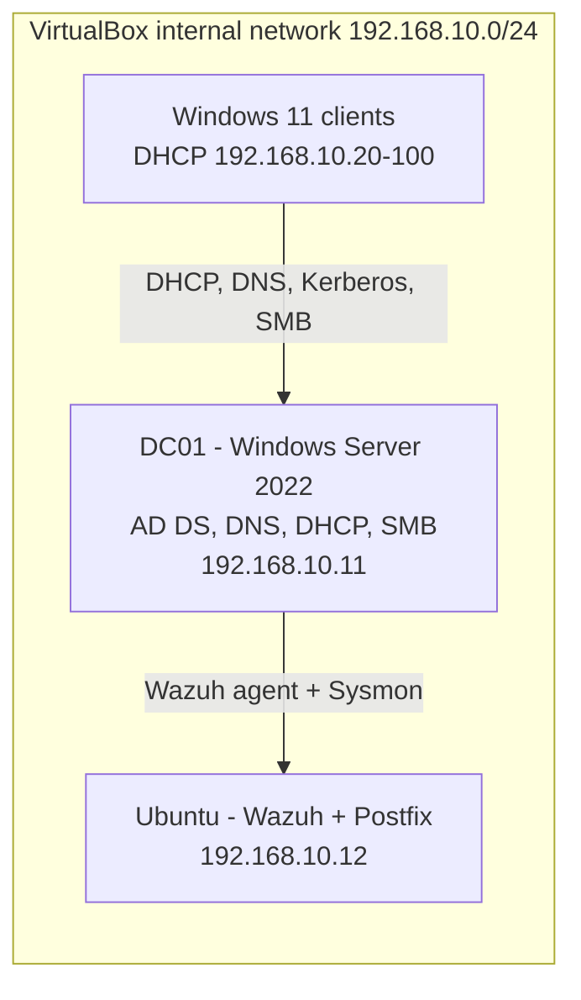

# AD Helpdesk Home Lab (Active Directory, DHCP, GPO, SMB)

🇬🇧 **English** | [🇵🇱 Polski](README.pl.md)

A virtualized, company-style environment for practicing day-to-day IT Support / Service Desk work: user and group administration, DHCP and DNS troubleshooting, Group Policy and file shares. Built on Oracle VirtualBox.

## Architecture

| Machine | System | Role | Address |
|---|---|---|---|
| DC01 | Windows Server 2022 Standard (Evaluation) | AD DS, DNS, DHCP, SMB share | 192.168.10.11 (static) |
| Ubuntu LAB | Ubuntu | Wazuh manager, Postfix (see [wazuh-siem-homelab](../wazuh-siem-homelab)) | 192.168.10.12 (static) |
| Win11 clients | Windows 11 Pro / Enterprise (Evaluation) | Domain-joined workstations | DHCP, 192.168.10.20-100 |

## What is configured

- Domain `cyberlab.local` on DC01, two Windows 11 clients joined to it.
- OU structure: `Pracownicy` (Employees) with `Admin`, `HR`, `IT`, `SPRZEDAZ` (Sales); plus `Komputery` and `Uzytkownicy`.
- DHCP scope `lab-scope`: 192.168.10.20 - 192.168.10.100 /24, 8-day lease. Static servers (.11, .12) stay outside the scope to avoid IP conflicts.
- Group Policy blocking Command Prompt and Control Panel for employees. Verified with `gpresult /r` for a user in OU `SPRZEDAZ`.
- SMB share `Dane Firmowe` on DC01, mapped as drive `Z:` on the clients.
- Helpdesk-style tasks: creating users, password reset, enabling and disabling accounts, moving users between OUs.

## Evidence

| | |
|---|---|
|  **Client joined to `cyberlab.local`** |  **Domain user logged on (`whoami`)** |
|  **OU structure** |  **GPO linked, Command Prompt disabled on the client** |
|  **`gpresult /r`: policy applied to a user in OU SPRZEDAZ** |  **SMB share and mapped drive** |
|  **DHCP scope** |  **Client lease from 192.168.10.11 (`ipconfig /all`)** |
|  **Employee account logon** | |

## Troubleshooting write-ups

Real problems from this lab, written as runbooks: [helpdesk-runbooks](../helpdesk-runbooks).

## Known issues and next steps

- The DHCP router option currently points at DC01. Replace it with a real gateway (pfSense is planned).
- DC01 also registers its NAT address in DNS, which can make clients resolve the wrong IP. Disable DNS registration on that adapter.
- No reverse lookup zone yet (`nslookup` shows `Server: UnKnown`).
- Evaluation licences expire (Server 180 days, Windows 11 Enterprise 90 days). I keep snapshots and document the setup so the lab can be rebuilt.
- NTFS permissions test: screenshot of the Security tab and Effective Access to be added.

## Disclaimer

Isolated lab with test accounts and evaluation software. No production data.
