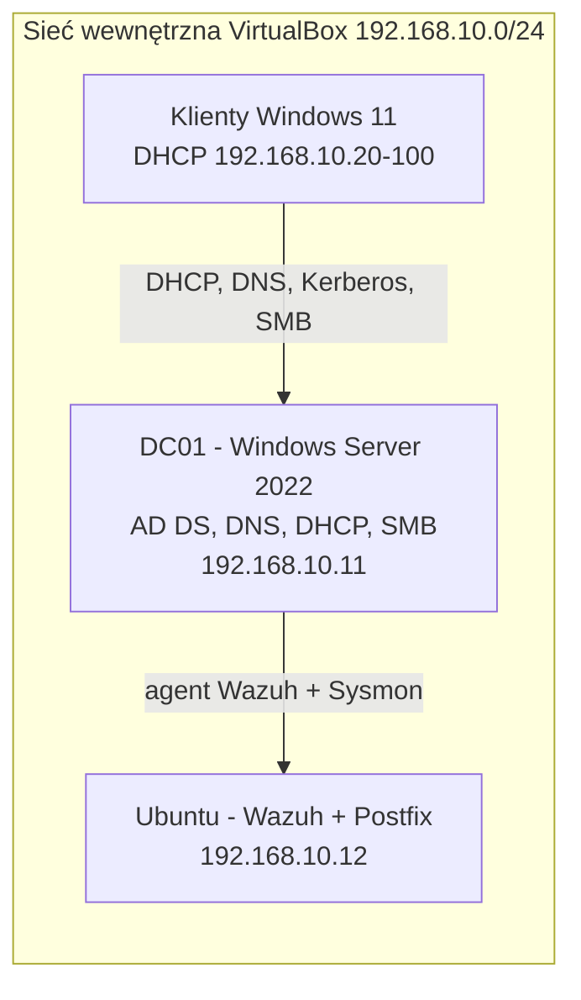

# AD Helpdesk Home Lab (Active Directory, DHCP, GPO, SMB)

[🇬🇧 English](README.md) | 🇵🇱 **Polski**

Zwirtualizowane środowisko w stylu firmowym do ćwiczenia codziennej pracy IT Support / Service Desk: administracja użytkownikami i grupami, diagnostyka DHCP i DNS, Group Policy oraz udziały plikowe. Zbudowane w Oracle VirtualBox.

## Architektura

| Maszyna | System | Rola | Adres |
|---|---|---|---|
| DC01 | Windows Server 2022 Standard (Evaluation) | AD DS, DNS, DHCP, udział SMB | 192.168.10.11 (statyczny) |
| Ubuntu LAB | Ubuntu | Menedżer Wazuh, Postfix (zob. [wazuh-siem-homelab](../wazuh-siem-homelab)) | 192.168.10.12 (statyczny) |
| Klienty Win11 | Windows 11 Pro / Enterprise (Evaluation) | Stacje robocze w domenie | DHCP, 192.168.10.20-100 |

## Co jest skonfigurowane

- Domena `cyberlab.local` na DC01, dwa klienty Windows 11 dołączone do domeny.
- Struktura OU: `Pracownicy` z jednostkami `Admin`, `HR`, `IT`, `SPRZEDAZ`; oprócz tego `Komputery` i `Uzytkownicy`.
- Zakres DHCP `lab-scope`: 192.168.10.20 - 192.168.10.100 /24, dzierżawa 8 dni. Serwery ze stałymi adresami (.11, .12) są poza zakresem, żeby uniknąć konfliktów IP.
- Group Policy blokujące Wiersz poleceń i Panel sterowania dla pracowników. Sprawdzone przez `gpresult /r` dla użytkownika z OU `SPRZEDAZ`.
- Udział SMB `Dane Firmowe` na DC01, zmapowany jako dysk `Z:` na klientach.
- Zadania w stylu helpdesku: tworzenie użytkowników, reset hasła, włączanie i wyłączanie kont, przenoszenie między OU.

## Dowody

| | |
|---|---|
|  **Klient dołączony do `cyberlab.local`** |  **Zalogowany użytkownik domenowy (`whoami`)** |
|  **Struktura OU** |  **GPO podpięte, Wiersz poleceń zablokowany na kliencie** |
|  **`gpresult /r`: polityka zastosowana dla użytkownika z OU SPRZEDAZ** |  **Udział SMB i zmapowany dysk** |
|  **Zakres DHCP** |  **Dzierżawa klienta z 192.168.10.11 (`ipconfig /all`)** |
|  **Logowanie konta pracownika** | |

## Opisy rozwiązanych problemów

Prawdziwe problemy z tego labu zapisane jako runbooki: [helpdesk-runbooks](../helpdesk-runbooks).

## Znane problemy i następne kroki

- Opcja routera w DHCP wskazuje obecnie na DC01. Zamienię ją na prawdziwą bramę (planowany pfSense).
- DC01 rejestruje w DNS także adres z karty NAT, przez co klienci mogą dostać zły IP. Do wyłączenia rejestracji DNS na tej karcie.
- Brak strefy wyszukiwania wstecznego (`nslookup` pokazuje `Server: UnKnown`).
- Licencje Evaluation wygasają (Server 180 dni, Windows 11 Enterprise 90 dni). Trzymam snapshoty i dokumentuję konfigurację, żeby dało się odtworzyć lab.
- Test uprawnień NTFS: zrzut karty Zabezpieczenia i Effective Access do dodania.

## Zastrzeżenie

Odizolowany lab z kontami testowymi i oprogramowaniem Evaluation. Brak danych produkcyjnych.
